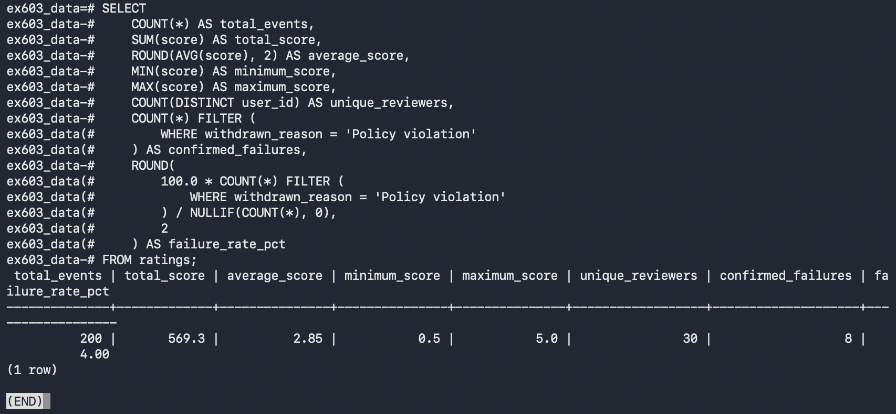
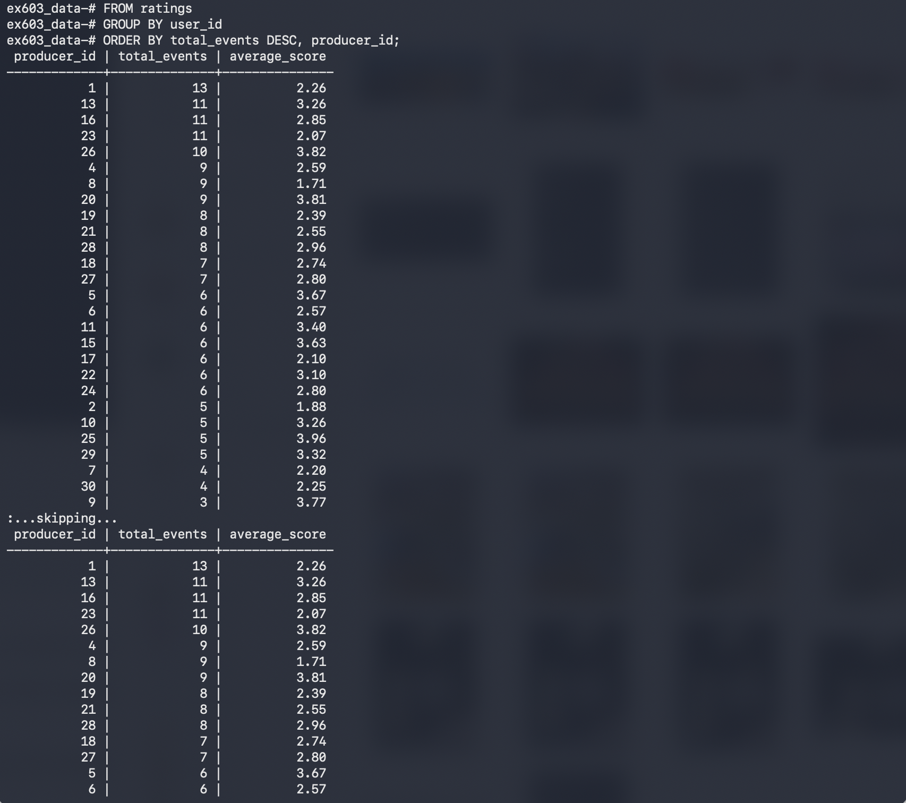
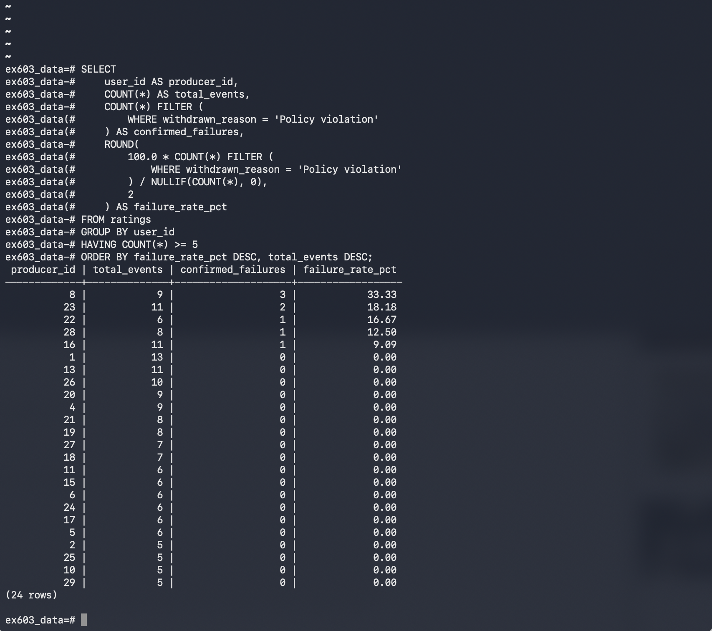
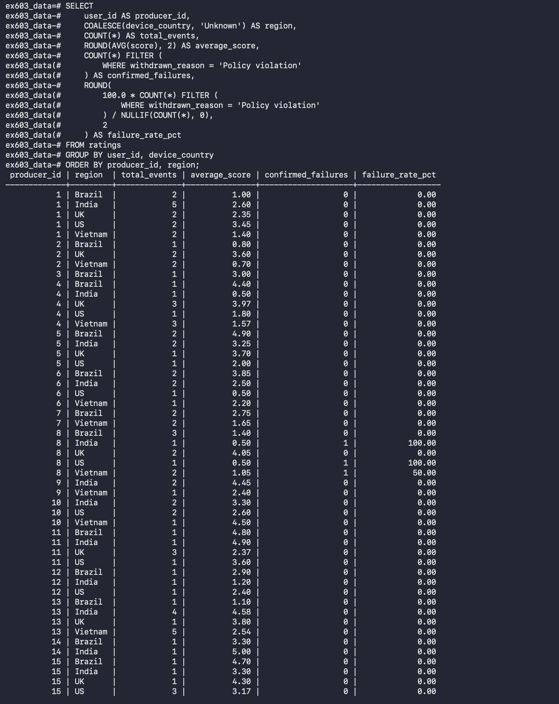
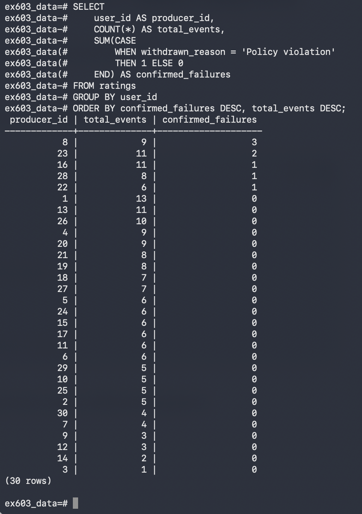
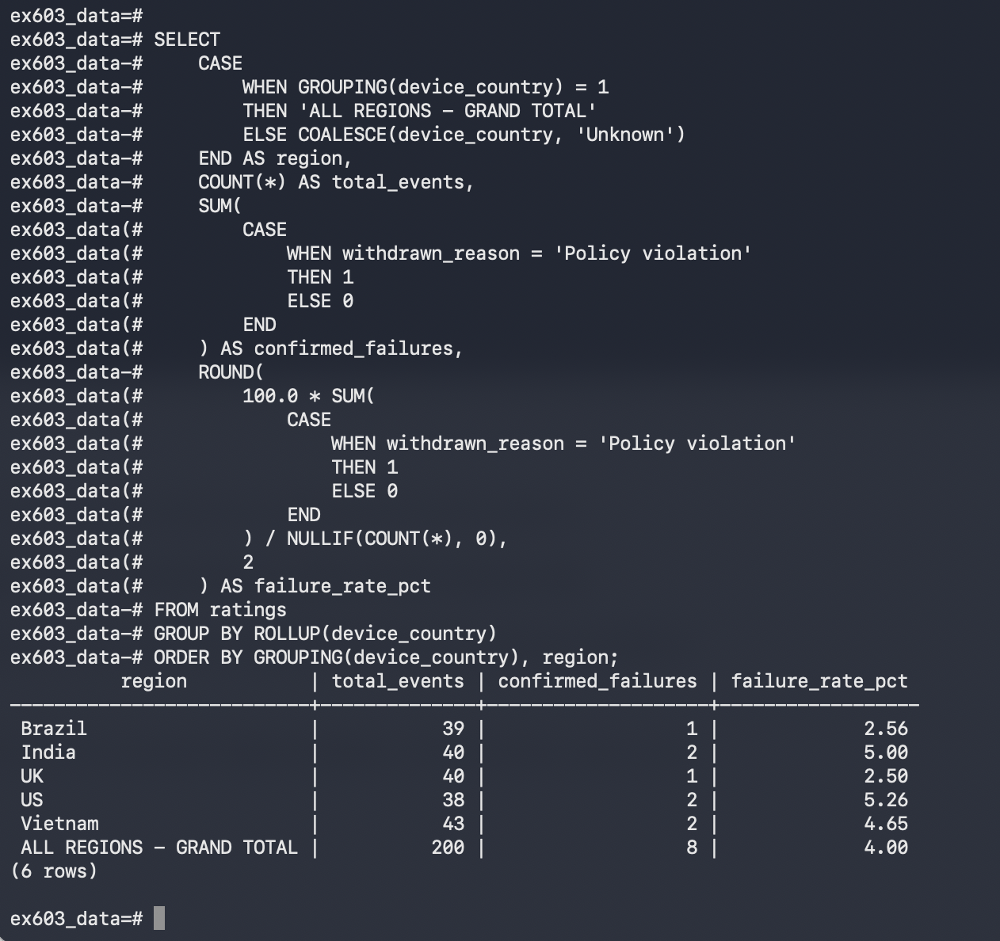
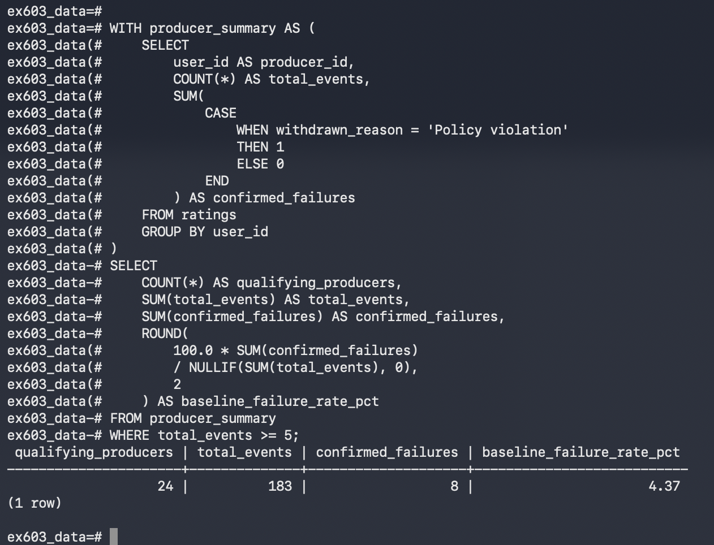

# Unit 4 Analysis: Movie/TV Database Performance

## Task 4.1: Measuring Platform Performance

### Platform-Wide Statistics

The purpose of this analysis is to evaluate rating activity across the Movie/TV platform and determine how frequently confirmed policy violations occur. The analysis uses the `ratings` table, with each rating representing an event and each reviewer identified by `user_id`.

The SQL query calculates the total number of ratings, total rating score, average score, minimum score, maximum score, and number of distinct reviewers. It also calculates confirmed policy violations as a percentage of all ratings.

The query returned the following results:

- Total ratings: 200
- Total rating score: 569.3
- Average rating score: 2.85
- Minimum rating score: 0.5
- Maximum rating score: 5.0
- Unique reviewers: 30
- Confirmed policy violations: 8
- Overall confirmed failure rate: 4.00%

These results confirm the preliminary findings from Unit 3. Eight of the 200 ratings were associated with confirmed policy violations, resulting in an overall failure rate of 4.00%.

The minimum and maximum rating scores are also important because unexpected values could indicate data-quality problems requiring further investigation.

**Task 4.1.1 SQL Results:**

### Performance by Producer

For this analysis, each reviewer is treated as a producer and identified by `user_id` rather than name.

Grouping the data by reviewer makes it possible to compare rating activity and average scores. This breakdown is useful because a platform-wide average does not show whether a small number of reviewers account for a disproportionate share of problematic ratings.

The query identified 30 reviewers with different levels of activity. Producer 1 submitted the most ratings, with 13 and an average score of 2.26. Producers 13, 16, and 23 each submitted 11 ratings, with average scores of 3.26, 2.85, and 2.07, respectively.

These results demonstrate that reviewer activity and average scores vary across the platform.

The Trust and Safety Manager would use this information to identify reviewers who may require additional investigation. Before taking action, the manager should examine individual rating records, withdrawal reasons, and reviewer activity over time.

**Task 4.1.2 SQL Results:**

### Minimum Event Threshold

I selected a minimum threshold of five ratings per reviewer using the `HAVING` clause.

This threshold helps reduce the influence of reviewers with very little activity. For example, one confirmed violation among two ratings produces a 50% failure rate, but that percentage is based on a very small sample.

The query identified 24 reviewers who submitted at least five ratings.

Among those reviewers, the highest confirmed failure rates were:

| Producer ID | Total Ratings | Confirmed Failures | Failure Rate |
|---|---:|---:|---:|
| 8 | 9 | 3 | 33.33% |
| 23 | 11 | 2 | 18.18% |
| 22 | 6 | 1 | 16.67% |
| 28 | 8 | 1 | 12.50% |
| 16 | 11 | 1 | 9.09% |

Producer 8 had the highest confirmed failure rate, with three violations among nine ratings. Producer 23 had two violations among 11 ratings.

Five ratings is an initial screening threshold rather than a statistically definitive measure of reliability. Reviewers meeting this threshold can be compared more meaningfully, although additional data may still be necessary.

**Task 4.1.3 SQL Results:**

### Performance Across Regions

The regional analysis groups ratings by reviewer identifier and `device_country`.

This makes it possible to examine whether rating activity, average scores, and confirmed policy violations differ across geographic areas.

The `device_country` column represents the country associated with the rating event, rather than necessarily identifying the reviewer's residence.

The results demonstrate that individual reviewers can have different rating patterns across countries.

For example, Producer 8 recorded three confirmed policy violations across India, the United States, and Vietnam. The failure rates for those country-specific groups were 100.00%, 100.00%, and 50.00%, respectively. These percentages reflect very small numbers of ratings and should be interpreted cautiously.

Regional differences should not automatically be interpreted as evidence of misconduct. Differences in participation, sample sizes, and reporting practices may also influence the results.

**Task 4.1.4 SQL Results:**

## Task 4.2: Detailed Leadership Breakdown

### Part A: Conditional Aggregation

Conditional aggregation answers two questions side by side:

1. How many total ratings did each reviewer submit?
2. How many of those ratings were associated with confirmed policy violations?

Using `SUM(CASE WHEN ... THEN 1 ELSE 0 END)` allows both measurements to be calculated within the same grouped query.

The results identified Producer 8 as having the highest number of confirmed policy violations, with three violations across nine ratings. Producer 23 followed with two violations across 11 ratings.

Producers 16, 22, and 28 each had one confirmed violation. The remaining 25 reviewers had no confirmed violations recorded in this dataset.

The resulting breakdown helps leadership identify reviewers with unusually high numbers of confirmed violations. Reviewers with high violation counts and sufficient activity should receive additional attention before any decisions are made.

**Task 4.2A SQL Results:**

### Part B: Regional Subtotals and Grand Total

The Regional Director needs a summarized view of platform activity rather than individual reviewer records.

The `ROLLUP` query provides a subtotal for each device country and one platform-wide grand total.

The query returned the following results:

| Region | Total Ratings | Confirmed Failures | Failure Rate |
|---|---:|---:|---:|
| Brazil | 39 | 1 | 2.56% |
| India | 40 | 2 | 5.00% |
| UK | 40 | 1 | 2.50% |
| US | 38 | 2 | 5.26% |
| Vietnam | 43 | 2 | 4.65% |
| All Regions - Grand Total | 200 | 8 | 4.00% |

The United States had the highest regional failure rate at 5.26%, followed by India at 5.00% and Vietnam at 4.65%.

The grand total confirms that the platform recorded 200 ratings and eight confirmed policy violations, producing an overall failure rate of 4.00%.

The grand total supports decisions about overall platform performance and whether broader policy or reporting changes are necessary. Regional subtotals help identify where additional investigation or resources may be appropriate.

**Task 4.2B SQL Results:**

### Part C: Two-Step CTE Pipeline

The CTE pipeline answers the question: What is the combined confirmed failure rate among reviewers who submitted at least five ratings?

The first step summarizes the total ratings and confirmed failures for each reviewer. The second step filters those summaries to include reviewers meeting the minimum activity threshold and calculates their combined failure rate.

The query returned the following results:

- Qualifying reviewers: 24
- Total ratings from qualifying reviewers: 183
- Confirmed failures: 8
- Combined confirmed failure rate: 4.37%

The combined failure rate of 4.37% is slightly higher than the platform-wide rate of 4.00%.

This difference occurs because the qualifying group excludes reviewers who submitted fewer than five ratings. All eight confirmed violations occurred among reviewers meeting the minimum activity threshold.

This creates a baseline that leadership can use when evaluating higher-volume reviewers.

The combined rate is weighted by the number of ratings, so reviewers with more activity contribute proportionally more to the overall result.

**Task 4.2C SQL Results:**

## Reflection: Conditional Aggregation Versus Separate Queries

Conditional aggregation is useful because it allows multiple measurements to be calculated together without repeatedly filtering the entire dataset. In this assignment, I used conditional aggregation to calculate the total number of ratings submitted by each reviewer and the number associated with confirmed policy violations. These results appear side by side, making it easier to compare reviewer activity and identify potential concerns.

An alternative approach would involve running two separate queries. One query could count all ratings for each reviewer, while another could filter the data to count only policy violations. Although both approaches could produce the same information, separate queries would require additional processing and might require joining the results together afterward. Reviewers without violations could also be missing from the filtered results unless the queries were combined carefully.

When working with one million rows, efficiency becomes increasingly important. Repeatedly scanning large tables can increase processing time and database resource usage. Conditional aggregation allows the database to evaluate multiple conditions during a single grouped aggregation, potentially reducing unnecessary work.

Another advantage is consistency. Both measurements come from the same query and reflect the same underlying data snapshot. This makes the results easier to compare and explain to leadership.

Overall, conditional aggregation provides an organized and potentially more efficient way to summarize large datasets while supporting accurate, evidence-based decisions.

